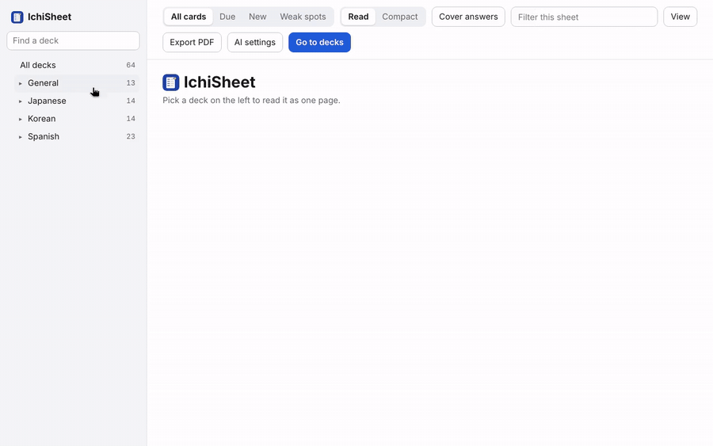

# Sheets (Anki add-on)

Install from AnkiWeb: https://ankiweb.net/shared/info/2018832541 (code `2018832541`).

Read any Anki deck as one scrollable page: prompt on the left, answer on the right, grouped by deck and `topic::` tag. Optional review ticks, adjustable columns and themes (View menu). Optional AI features (Condense, Ask) are off by default.

- `anki_sheets/` — the add-on. Zip its contents as `anki-sheets.ankiaddon` to install.
- `tests/` — `pytest tests` (needs the `anki` package). `fake_ai.py` is a stand-in AI server with canned answers.
- `docs/ankiweb-listing.md` — draft store listing and a pre-publish checklist; `docs/screenshots/` has the pictures for it.
- `scripts/export_public.sh` — makes a clean copy without git history, for a public repository.
- `demo/` — scripts that launch real Anki on a virtual display, click through the add-on and record it.

## Help

Bugs and ideas: https://github.com/StarHug/anki-sheets/issues

## Support

Sheets is free. If it saves you time and you'd like to help cover the cost of maintaining it, you can buy me a coffee:

## Licence

Licensed under the GNU Affero General Public License v3.0 or later, with additional terms: forks must keep the credit and support link, and must not claim to be the original. See `LICENSE`.
