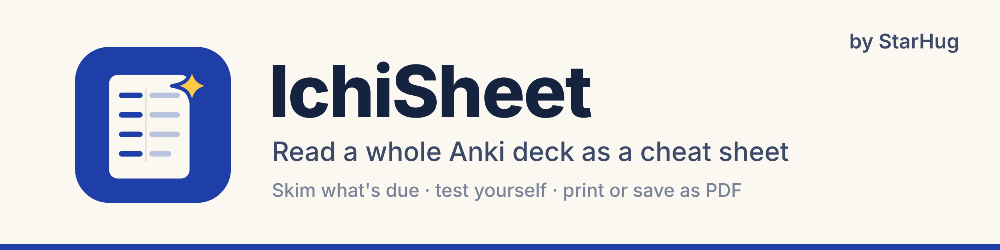
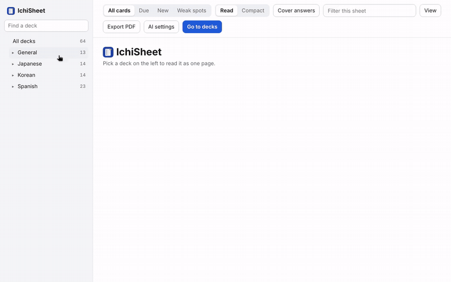
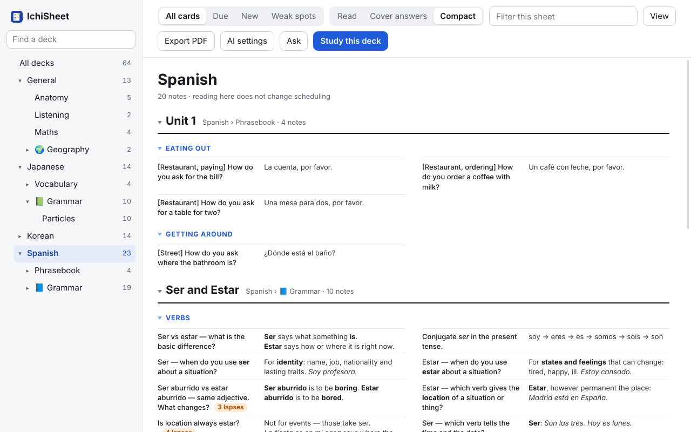
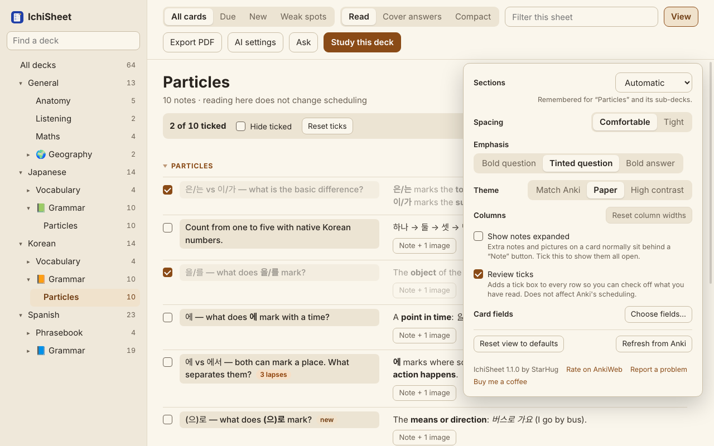
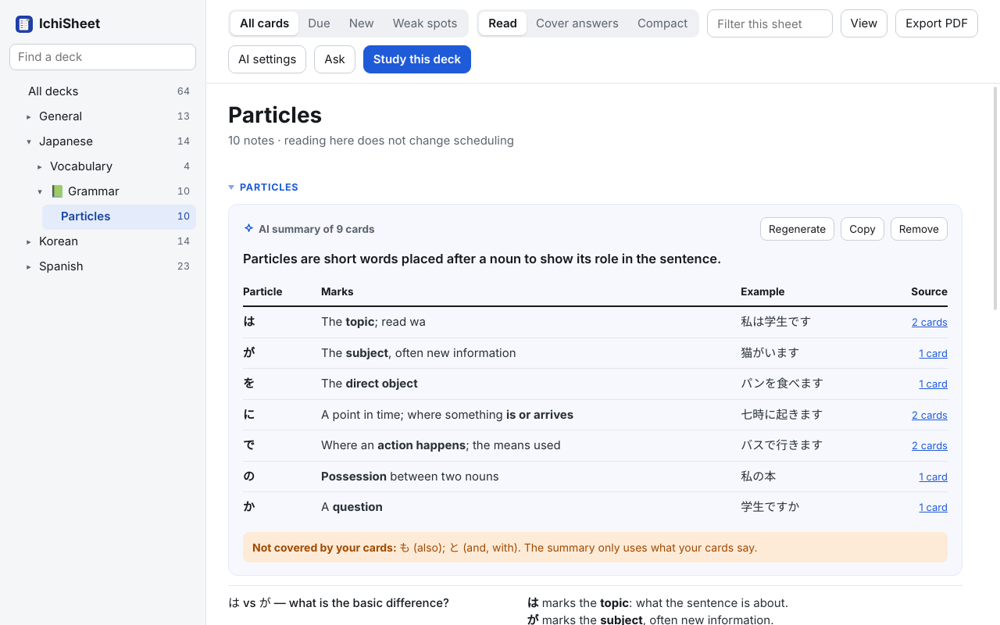

# AnkiWeb listing (draft)

**Title:** IchiSheet by StarHug: read a deck as a cheat sheet (skim, self-test, print)

**Tags:** sheet cheatsheet overview reading print pdf browse list export study

**Description:**

*IchiSheet was called Sheets until version 1.1.*

Flashcards are great for testing yourself, but sometimes you just want to *read* a deck: skim today's material, preview new cards before studying them, or print a cheat sheet. IchiSheet shows any deck as one scrollable page, with the question on the left and the answer on the right. Reading a sheet never changes your scheduling.

**To install:** in Anki, Tools → Add-ons → Get Add-ons, and paste the code **2018832541**. Then open it from Tools → IchiSheet, or the gear menu next to a deck → View as Sheet.

*Open a deck, expand a note, then cover the answers for a quick self-test.*

**What you get**

- **One page per deck.** Sub-decks are stacked under their own headings. Rows are split into sections by your tags (a tag family such as `topic::…`, or plain tags), or not at all.
- **Three ways to read.** *Read* shows everything. *Cover answers* hides answers until you click a row, for a quick self-test. *Compact* is a dense multi-column layout for printing.
- **Filters.** All cards, Due, New, or Weak spots (cards you keep forgetting, worst first). Type in the filter box to narrow further.
- **Notes and pictures.** Extra notes and pictures sit behind a "Note" button, and any picture opens full size. Sound files get a play button. Formulas (MathJax) and image-occlusion cards are supported.
- **Review ticks (optional).** Turn on tick boxes to check off rows as you read them. Ticks are a personal checklist and do not affect scheduling.
- **Layout and themes.** Resize the columns, set the spacing, choose which side is emphasised, and pick a theme. If the wrong field shows as the answer for one of your note types, pick the right one under View → Card fields.
- **Export PDF** of whatever is on screen.
- **Study this deck** jumps to Anki's normal review for the deck you are reading.

*Compact: a dense layout for printing.*

*Optional review ticks, and the View menu.*

**Optional AI features (off by default, experimental)**

With your own API key (Anthropic, or any OpenAI-compatible server including a local model), two extra buttons appear:

- **Condense** turns a section of cards into a short summary block (a table, steps or list) that links back to the cards it came from.
- **Ask** answers questions about the cards on the sheet and shows which cards the answer came from.

*Condense: a section of cards turned into a summary.*

**Private by default.** IchiSheet works fully offline. The AI features are optional and off by default. If you turn them on, card text goes straight from your computer to the AI provider you chose, and only when you ask for it. Pictures and audio are never sent, and you can mark any deck as private.

**Good to know**

- Large decks load 500 notes at a time, with a "Show more" button.
- Summaries, ticks and settings are stored in the add-on's own folder and your Anki profile, never in your collection.
- Desktop only. Use Export PDF to read a sheet on your phone.

**Requirements:** Anki 23.10 or later. Tested on Anki 23.10, 24.11 and 26.09.

**Help and bug reports**

Please don't use reviews for bug reports: I'm not notified of them and can't reply properly. [Open an issue on GitHub](https://github.com/StarHug/anki-sheets/issues) instead. Include your Anki version, your operating system, and a screenshot if something looks wrong.

**Source and licence**

The source code is on [GitHub](https://github.com/StarHug/anki-sheets). Open source under AGPL-3.0-or-later; see the LICENSE file for the terms that apply to copies and forks.

**Support this add-on**

IchiSheet is free and will stay free. If it saves you time, please [give it a thumbs up](https://ankiweb.net/shared/review/2018832541): it helps other people find it.

If you'd like to help cover the cost of building and maintaining it, you can buy me a coffee:

Thank you!

**Changelog**

1.1.0: new name. Sheets is now IchiSheet ("ichi" is Japanese for "one": your whole deck on one sheet). Nothing else changes; find it under Tools → IchiSheet.

1.0.4: an API key is never sent unencrypted to a server on the internet. A short About row at the bottom of the View panel: version, rate, report a problem, buy me a coffee.

1.0.3: security fix: code hidden in a card (for example from a shared deck) can no longer run inside IchiSheet, and a saved API key is only ever sent to the server it was entered for. Click a deck or section title to fold it. Drag the sheet's right edge to change its width. Long AI summaries no longer get cut off, and a broken AI reply is retried once. Clearer AI error messages. Copy button on AI summaries. Quieter scrollbars. Oversized card headings are capped.

1.0.2: drag the edge of the deck list to widen it (double-click to reset). Deck search shows each deck's own name first. AI settings has ready-made choices for OpenAI, Gemini, OpenRouter, Ollama and LM Studio. Buttons keep their shape when a theme add-on restyles Anki. PDF export fixed for long cards: no cut-off lists, oversized headings, printed scrollbars or blank pages.

1.0.1: the IchiSheet logo now shows beside the name in the app. New sample screenshots.

1.0.0: first public release.

---

## Before you publish

- [ ] Choose a licence and add a LICENSE file (most Anki add-ons use AGPL-3.0-or-later, the same as Anki).
- [ ] Create the public repository from `scripts/export_public.sh` output, not from the private repo (its history contains your own cards).
- [ ] Fill in the repository, licence and Ko-fi links above (done: repository, licence and Ko-fi).
- [ ] Check that your AnkiWeb account can upload: new accounts are blocked from uploading add-ons for a while, and staff are not making exceptions.
- [ ] Add 3 or 4 screenshots (see `docs/screenshots/`).
- [ ] Try it on Windows, or ask someone to.
